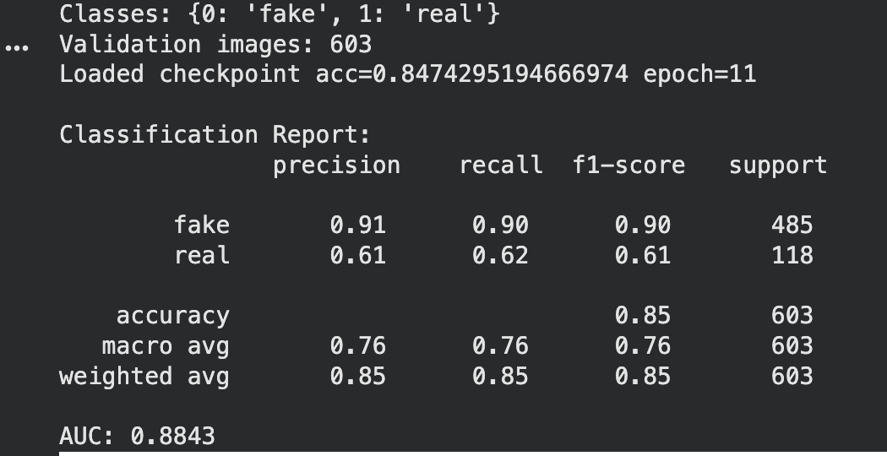
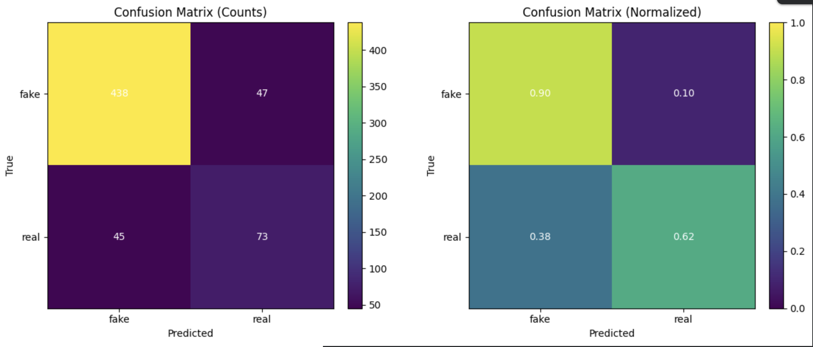
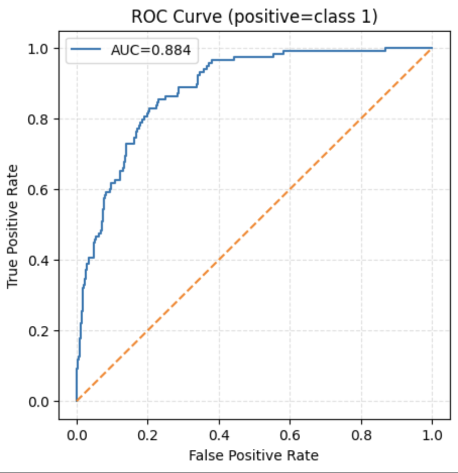
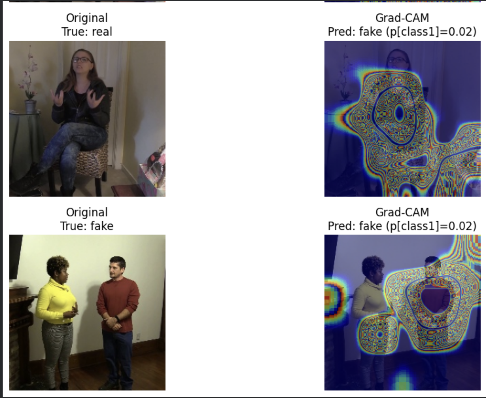

# Deepfake Detection with Grad-CAM and Blockchain

An end-to-end deepfake detection project exploring deep learning-based media classification, Grad-CAM visualizations for model interpretability, and blockchain integration for recording detection results.

## Features

- **Deepfake Detection:** Deep learning-based classification of real and manipulated media.
- **Grad-CAM Visualization:** Visual explanations of image regions that influence model predictions.
- **Blockchain Integration:** Explores recording detection results using blockchain technology.
- **Google Colab Notebook:** Includes a notebook for running and experimenting with the project.

## Repository Structure

```text
Deepfake-Detection/
├── notebooks/
│   └── deepfake_detection_colab.ipynb
├── scripts/
├── models/
├── outputs/
├── requirements.txt
├── .gitignore
├── LICENSE
└── README.md
```

*Note: Some folders may be empty or used to store generated files locally.*

## Getting Started

### 1. Clone the repository

```bash
git clone https://github.com/LIKHITH-likhi844/Deepfake-Detection.git
cd Deepfake-Detection
```

### 2. Install dependencies

```bash
pip install -r requirements.txt
```

### 3. Open the notebook

Open `notebooks/deepfake_detection_colab.ipynb` in Google Colab or Jupyter Notebook and follow the notebook cells to run the workflow.

## Dataset

This project may require a deepfake dataset for training and evaluation. Download the dataset separately and update the dataset path in the notebook to match your environment.

**The dataset is not included in this repository** because of its large size.
## Model Evaluation

The model was evaluated on a validation set of 603 images.

| Metric | Result |
|---|---:|
| Validation Accuracy | 84.74% |
| ROC-AUC | 0.8843 |
| Fake Class F1-score | 0.90 |
| Real Class F1-score | 0.61 |

The model performs better on fake-image classification than on real-image classification. Further evaluation and improvements may help balance performance across both classes.

### Classification Report



### Confusion Matrix

The following image contains both count-based and normalized confusion matrices.



### ROC Curve



### Prediction Example


## Technologies Used

- Python
- Deep Learning
- EfficientNet-B0
- Grad-CAM
- Google Colab
- Blockchain / Web3

## Notes

- Install all required dependencies before running the notebook.
- Update dataset and file paths for your environment.
- Actual results depend on the dataset, model weights, and execution environment.

## Author

**Likhith**

GitHub: https://github.com/LIKHITH-likhi844
